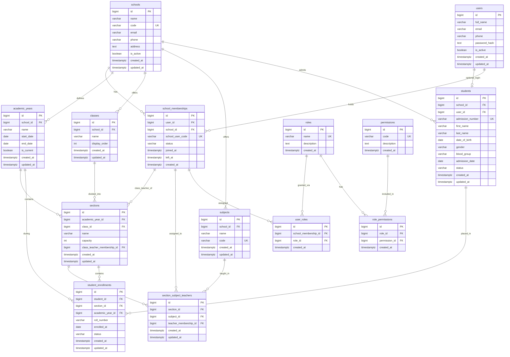

# School Management Platform — Database Schema

This document tracks the evolving database design, entity relationships, and authorization architecture.

---

## Visual ER Diagram

---

## Table Definitions & Responsibilities

### Core Identity & Tenancy Tables

#### 1. `schools`
* **Responsibility:** Multi-tenant container. Represents individual schools (e.g., `ABC School`, `XYZ School`).
* **Key Columns:** `id` (PK), `code` (UNIQUE, e.g. `ABC001`), `name`, `is_active`.

#### 2. `users`
* **Responsibility:** Global account identity (login credentials, person profile).
* **Key Columns:** `id` (PK), `full_name`, `email` (nullable, not globally unique), `phone`, `password_hash`.
* **Design Rule:** Deliberately contains **no** `school_id` so an account can belong to multiple schools.

#### 3. `school_memberships`
* **Responsibility:** Links a user account to a specific school tenant.
* **Key Columns:** `id` (PK), `user_id` (FK), `school_id` (FK), `school_user_code` (UNIQUE per membership, e.g. `ABC001000501`), `status` (`active`, `inactive`, `pending`).

---

### Academic Structure & Data Scope Tables

#### 4. `academic_years`
* **Responsibility:** Tracks temporal sessions/years per school (e.g., `"2026-2027"`).
* **Key Columns:** `id` (PK), `school_id` (FK), `name`, `start_date`, `end_date`, `is_current`.
* **Integrity Constraints:**
  * `uq_school_academic_year_name`: `UNIQUE(school_id, name)` — Prevents duplicate session names for the same school.
  * `chk_academic_year_dates`: `CHECK(end_date > start_date)` — Enforces chronological date order.
  * `uq_one_current_year_per_school`: **Partial Unique Index** on `(school_id) WHERE is_current = TRUE` — Enforces at most one active year per school.

#### 5. `classes`
* **Responsibility:** Permanent grade/standard levels offered by a school (e.g., `Grade 9`, `Grade 10`).
* **Key Columns:** `id` (PK), `school_id` (FK), `name`, `display_order`, `created_at`, `updated_at`.
* **Integrity Constraints:**
  * `uq_school_class_name`: `UNIQUE(school_id, name)` — Prevents duplicate class names within a school.
  * `idx_classes_school_order`: Index on `(school_id, display_order)` for proper UI sorting and promotion logic.

#### 6. `sections`
* **Responsibility:** Active cohorts in an academic year (e.g., `Grade 10 - Section A` in `2026-2027`).
* **Key Columns:** `id` (PK), `academic_year_id` (FK), `class_id` (FK), `name` (e.g. `'A'`), `capacity`, `class_teacher_membership_id` (FK -> `school_memberships.id`).
* **Integrity Constraints:**
  * `uq_academic_year_class_section`: `UNIQUE(academic_year_id, class_id, name)` — Prevents duplicate sections in the same class/year.
  * `fk_section_class_teacher`: References `school_memberships(id)` with `ON DELETE SET NULL` to preserve section history if teacher assignment changes.

#### 7. `subjects`
* **Responsibility:** Subject catalog offered by a school (e.g., `Mathematics`, `Physics`, `English`).
* **Key Columns:** `id` (PK), `school_id` (FK), `name`, `code` (e.g. `MATH`), `created_at`, `updated_at`.
* **Integrity Constraints:**
  * `uq_school_subject_code`: `UNIQUE(school_id, code)` — Prevents duplicate subject codes within a school.

#### 8. `section_subject_teachers`
* **Responsibility:** **The Data Scope Junction.** Assigns a specific teacher to teach a subject to a section.
* **Key Columns:** `id` (PK), `section_id` (FK), `subject_id` (FK), `teacher_membership_id` (FK -> `school_memberships.id`).
* **Integrity Constraints:**
  * `uq_section_subject`: `UNIQUE(section_id, subject_id)` — Assigns one designated teacher per subject for that section.
  * `idx_sst_teacher`: Critical index on `(teacher_membership_id)` used to authorize API calls for marking attendance and entering grades.

---

### Student Domain Tables

#### 9. `students`
* **Responsibility:** Permanent student profile created once at admission. Stays unchanged year after year.
* **Key Columns:** `id` (PK), `school_id` (FK), `user_id` (FK, nullable — not every student needs a portal login), `admission_number` (UNIQUE per school), `first_name`, `last_name`, `date_of_birth`, `gender`, `blood_group`, `admission_date`, `status`.
* **Integrity Constraints:**
  * `uq_school_admission_number`: `UNIQUE(school_id, admission_number)` — Prevents duplicate admission numbers within a school.
  * `chk_student_status`: `CHECK(status IN ('active', 'alumni', 'transferred', 'suspended'))`.
  * `chk_student_gender`: `CHECK(gender IN ('male', 'female', 'other'))`.
  * `fk_student_user`: `ON DELETE SET NULL` — If a portal account is removed, the student record survives.

#### 10. `student_enrollments`
* **Responsibility:** Places a student into a specific section for a specific academic year with a roll number. Changes every year when students are promoted.
* **Key Columns:** `id` (PK), `student_id` (FK), `section_id` (FK), `academic_year_id` (FK — controlled denormalization), `roll_number`, `enrolled_at`, `status`.
* **Integrity Constraints:**
  * `uq_student_academic_year`: `UNIQUE(student_id, academic_year_id)` — **One student, one section, one year.** Prevents a student from being enrolled in two sections in the same academic year.
  * `uq_section_roll_number`: `UNIQUE(section_id, roll_number)` — Roll numbers are unique within a section.
  * `chk_enrollment_status`: `CHECK(status IN ('enrolled', 'promoted', 'detained', 'transferred'))`.
* **Design Note:** `academic_year_id` is deliberately stored here even though `section_id` already carries it. This **controlled denormalization** allows the database to enforce the one-student-per-year rule directly, without needing application logic.

---

### Role-Based Access Control (RBAC) Tables

#### 11. `roles`
* **Responsibility:** Standard roles within school context (e.g., `Teacher`, `Principal`, `Accountant`, `Parent`, `Student`).
* **Key Columns:** `id` (PK), `name` (UNIQUE), `description`, `created_at`.

#### 12. `permissions`
* **Responsibility:** Fine-grained atomic actions.
* **Examples:** `attendance.view`, `attendance.mark`, `fees.collect`, `student.register`.
* **Key Columns:** `id` (PK), `code` (UNIQUE), `description`, `created_at`.

#### 13. `user_roles`
* **Responsibility:** Assigns roles to an account **within a specific school**.
* **Key Columns:** `id` (PK), `school_membership_id` (FK -> `school_memberships.id`), `role_id` (FK -> `roles.id`), `created_at`.
* **Crucial Architectural Rule:** References `school_membership_id`, **not** `user_id`. Guarantees school isolation.

#### 14. `role_permissions`
* **Responsibility:** Junction mapping roles to their allowed permissions.
* **Key Columns:** `id` (PK), `role_id` (FK), `permission_id` (FK), `created_at`.
